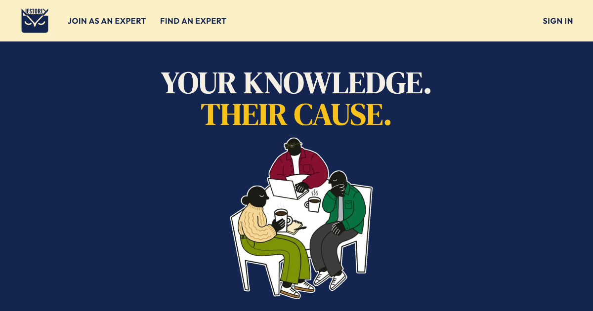
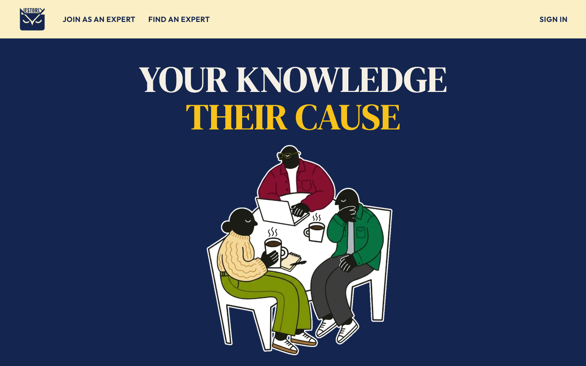
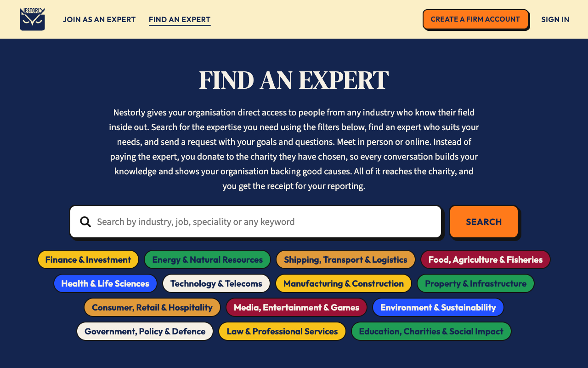
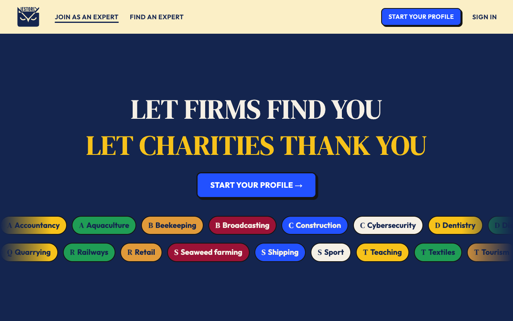
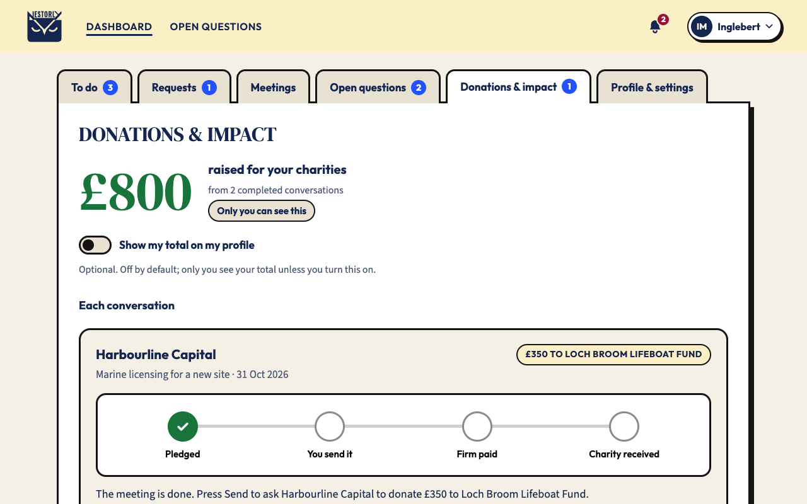
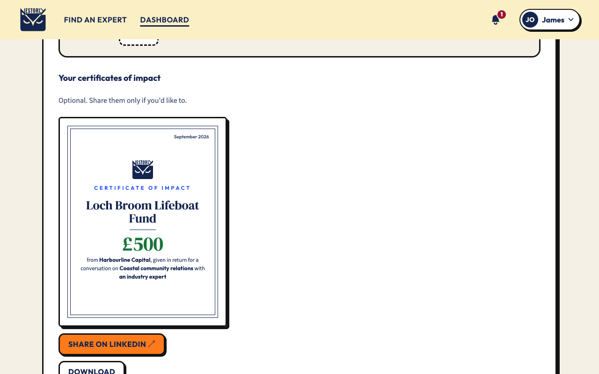

# Nestorly

**Specialise for charity.** Experts share what they know with organisations that need it. Instead of paying the expert, the organisation donates, in full, to a charity the expert has chosen.

### [▶ Open the live prototype: luke-w-l-m.github.io/nestorly-prototype](https://luke-w-l-m.github.io/nestorly-prototype)

---

## What it is

Nestorly is a planned community interest company (CIC): a marketplace that connects people who know their field inside out with firms, investors and organisations looking for that knowledge.

- **Experts** (mostly 40+, still working, retired or specialists in any field) create a profile and choose one UK charity they care about.
- **Firms** search by industry, job or keyword, and send a request with their goals and questions.
- **The donation** goes straight from the firm to the charity's own donation page. **100% reaches the charity. Nestorly never touches the money.**

No contracts, no selling yourself: just your expertise, put to work for a cause you care about.

## How it works

| | Step | What happens |
|---|---|---|
| 1 | **They ask** | A firm requests a call, written advice, a site visit, a talk or mentoring, and pledges a donation to the expert's charity. |
| 2 | **You share** | The expert accepts or declines. If they accept, they meet and share what they know, on their own terms. |
| 3 | **You send it** | After the meeting, the expert presses **Send** to release the pledged donation. |
| 4 | **Firm paid** | The firm donates directly on the charity's website and uploads its receipt. |
| 5 | **Charity received** | The charity confirms the donation, and both sides get an official **certificate of impact**, optional to share on LinkedIn. |

## Screenshots

| Homepage | Find an expert |
|---|---|
|  |  |
| **Join as an expert** | **Expert dashboard: my impact** |
|  |  |
| **Firm certificate of impact** | |
|  | |

## Try it

The prototype works like the real site: everything you do is saved in your browser and shows up everywhere it should. Nothing leaves your browser, and no emails or payments are real.

**Sample sign-ins** (use *Sign in* → type the email → *Email me a sign-in link* → *Open the link*, or *Continue with Google / LinkedIn* and pick an account):

| Who | Email | Role |
|---|---|---|
| Inglebert Montgomery-Smythe | `inglebert@example.co.uk` | Expert, with past meetings, donations and certificates |
| James Okafor, Harbourline Capital | `james.okafor@harbourline.example.com` | Firm (investor, Reliable donor) |
| Sarah Lindqvist, Northgate Foods | `sarah.lindqvist@northgatefoods.example.com` | Firm (company) |
| Tom Reyes, Fenwick Events | `tom.reyes@fenwickevents.example.com` | Firm (event organiser) |

The account decides where you land: experts go to the expert dashboard, firms to the firm dashboard.

**The full journey** (about ten minutes):

1. **Join as an expert** → *Start your profile* → *Continue* through the eight steps (sample answers are filled in) → *Publish my profile* → *You're live!* → *Go to my dashboard*. Then sign out from the account menu.
2. **Find an expert** → *Create a firm account* → five steps → *Simulate verification* → *Find an expert*.
3. Search "harbour" → open the new expert → *Save* → *Request a conversation* → *Prototype only: fill in sample answers* → *Send request*.
4. Sign out, sign in as the expert. The bell shows the new request → *Accept…* → pick a time, tick the declarations → *Confirm and accept*. Send a message on the request.
5. *Join video call* → *Prototype: let them join* → *Leave* → *Mark as done* → *Send to [charity]*.
6. Sign in as the firm → *Donations & receipts* → *Donate to [charity]* (a pretend charity page) → *Donate* → back to Nestorly → *Use a sample receipt* → *Submit receipt*. About 5 seconds later the charity confirms and both sides get a certificate of impact.
7. Open **Emails** in the footer to see every email the journey would have sent.

**Also worth trying:** open questions (firms post them, experts raise a hand), suggesting a different meeting time from either side, *Add to calendar* (downloads a .ics file), the receipts CSV export, pausing a profile, and *See my profile as firms do*.

**Start again:** *Reset prototype* in the footer clears everything you've created and puts the sample data back.

## Pages

| Page | File | Purpose |
|---|---|---|
| Homepage | [`index.html`](index.html) | What Nestorly is, how it works, the donation tracker and certificates |
| Join as an expert | [`join.html`](join.html) | Who it's for, how firms find you, what you'll need, an example and FAQs |
| Create your profile | [`create-profile.html`](create-profile.html) | Eight-step expert sign-up, then *You're live!* with ready-made sharing posts |
| Find an expert | [`find.html`](find.html) | Search by industry, job or keyword; full profiles and saving for signed-in firms |
| Create a firm account | [`firm-signup.html`](firm-signup.html) | Five steps: details, organisation, agree, verify, done |
| Sign in | [`signin.html`](signin.html) | One sign-in for experts and firms: emailed link, Google or LinkedIn |
| Request a conversation | [`request.html`](request.html) | Goals, questions, format, three times, the donation and a signed pledge |
| Expert dashboard | [`expert-dashboard.html`](expert-dashboard.html) | To do, requests, meetings, open questions, donations and impact, profile and settings |
| Firm dashboard | [`firm-dashboard.html`](firm-dashboard.html) | To do, requests, meetings, open questions, saved experts, donations and receipts, organisation |
| Video call | [`call.html`](call.html) | The Nestorly call room: names, topic, timer, mic and camera, attendance |
| Charity donation page | [`charity.html`](charity.html) | A pretend charity website where the firm donates (no payment is taken) |
| Emails | [`emails.html`](emails.html) | Every email the prototype would have sent, and the email designs |
| Small print | [`legal.html`](legal.html) | Terms, privacy, code of conduct and cookies |

## Design

- **Typefaces:** DM Serif Display (headings), Source Sans 3 (body), Outfit (buttons and labels)
- **Colours:** cream `#F5F0E6` · navy `#14254F` · cobalt `#2251FF` · burgundy `#7A1F2B` · sun `#F6C344` · donation green `#18743A`
- **Style:** bold outlines and hard shadows, wavy colour bands and large, readable text, designed for an audience mostly aged 50+.

## Built with

Plain HTML, CSS and JavaScript with no build step, hosted on [GitHub Pages](https://pages.github.com/). The shared data (sample experts, firms, requests, messages, alerts and emails) lives in [`store.js`](store.js), saved in the browser's local storage. Shared header, footer, bell, account menu and donation tracker live in [`site.js`](site.js); the dashboards are [`expert-dashboard.js`](expert-dashboard.js) and [`firm-dashboard.js`](firm-dashboard.js); design tokens and components live in [`styles.css`](styles.css).

## Status

This is a **working click-through prototype with invented sample data**. Everything is saved only in your own browser. The people, firms and charities shown are fictional, and no sign-ins, payments, video calls or emails are real. The full site (accounts, database and email sending) is planned next. *Nestorly* is a working name.

---

© 2026 Nestorly CIC (in formation) · Made by <a href="https://github.com/Luke-W-L-M">Luke Melville</a>

